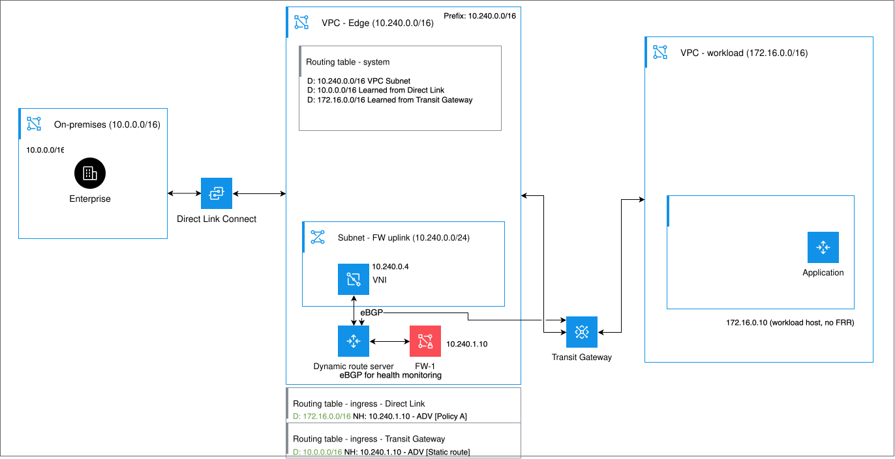

---

copyright:
  years: 2026
lastupdated: "2026-11-03"

keywords: dynamic route server, architecture, BGP, appliance, GRE, high availability

subcollection: vpc

---

{{site.data.keyword.attribute-definition-list}}

# Architecture
{: #drs-architecture}

[Dynamic Route Server for VPC](/docs/vpc?topic=vpc-release-notes#vpc-oct2126) is a beta feature that is available for evaluation and testing purposes to select customers. Access is restricted to allowlisted accounts.
{: beta}

Dynamic Route Server for VPC automates the management of routing in complex network topologies. Instead of manually maintaining static routes as workloads, firewalls, and connected networks change, you define routing policies once, and the dynamic route server keeps your VPC routing tables up to date automatically. It uses Border Gateway Protocol (BGP) to learn routes from connected peers and applies your policies to determine which routes are added to VPC routing tables, reflected to other peers, or advertised back to connected networks.
{: shortdesc}

A dynamic route server doesn't sit in the data path. Traffic between your workloads and connected networks follows the routes that the dynamic route server adds to your VPC routing tables, and not through the dynamic route server itself.

## Key concepts
{: #drs-architecture-concepts}

Understand the following concepts, which help you plan and configure a dynamic route server.

### Members
{: #drs-architecture-members}

A dynamic route server instance is made up of one or more members. Each member is a routing appliance that is managed by {{site.data.keyword.cloud_notm}} and deployed in the availability zone of the virtual network interface (VNI) that you provide. Members establish BGP sessions with your peers and exchange routing information on behalf of the dynamic route server instance.

You can create up to three members for a dynamic route server instance. You can deploy all three members in the same availability zone or distribute them across availability zones. For zone-level redundancy, create three members and deploy one in each availability zone.
{: note}

### Peers and peer groups
{: #drs-architecture-peers}

A peer is any BGP-capable network device that the dynamic route server connects to, such as a firewall, router, SD-WAN device, or an {{site.data.keyword.tg_full}} connection. Peers are organized into peer groups so that routing behavior, health monitoring, and route filters can be defined once and applied consistently to all members of the group.

A peer group can have one of the following roles:

Router
:   The peer exchanges routes with the dynamic route server by using BGP. Use this role for devices that advertise and learn routes, such as routers or SD-WAN devices.

Next hop
:   The peer is a forwarding target only. The dynamic route server adds routes to VPC routing tables that point to this peer as the next hop, but the peer does not advertise routes. Use this role for firewalls or security appliances through which traffic must pass for inspection.

### Routing policies
{: #drs-architecture-policies}

Routing policies, which are defined at the peer group level, control what the dynamic route server does with routes. The following policy types are supported:

VPC routing table
:   Adds routes that are learned from a peer group to a VPC ingress or egress routing table, optionally pointing traffic to a specified next-hop peer group such as a firewall. Routes are added and removed automatically based on the health of the next-hop peers.

Learned routes
:   Reflects routes that are learned from one peer group to other router peer groups. Use this policy when the dynamic route server acts as a route reflector between different routing domains, for example between a transit gateway and an overlay network router.

Custom routes
:   Advertises static, custom-defined routes to a peer group over BGP. Use this policy to inform peers of fixed network paths, such as an on-premises CIDR range.

VPC address prefixes
:   Advertises the VPC address prefixes to router peers so that external routers and on-premises devices can learn how to reach VPC workloads.

### Health monitoring and automatic failover
{: #drs-architecture-health}

When health monitoring is enabled on a peer group, the dynamic route server continuously checks whether peers are reachable. If a peer becomes unavailable, the dynamic route server automatically removes routes that depend on that peer from VPC routing tables, preventing traffic from being sent to an unreachable destination. When the peer recovers, routes are reinstated without manual intervention.

You can choose the detection method that best matches your requirements:

* **BFD over BGP** - Bidirectional Forwarding Detection (BFD) detects network failures in less than one second. This option is recommended for next-hop peer groups, such as firewalls, where fast failover is critical.
* **BGP** - Uses BGP keepalive and hold timers. Failure is detected when the BGP session drops.
* **None** - Disables health monitoring, so routes are not removed when a peer fails. Use this option only when the peer doesn't support BGP.

### Transit Gateway integration
{: #drs-architecture-tgw}

You can connect a dynamic route server to an {{site.data.keyword.tg_full}} to participate in route exchange across all networks that are connected to the transit gateway, including Direct Link, other VPCs, and Power virtual server environments. When the connection is created, the transit gateway automatically establishes redundant BGP sessions to each dynamic route server member. The dynamic route server learns routes that the transit gateway advertises and can use policies to add those routes into VPC routing tables or reflect them to other peers.

A dynamic route server instance can be connected to only one transit gateway at a time. For more information, see [About IBM Cloud Transit Gateway](/docs/transit-gateway?topic=transit-gateway-about).

## How a dynamic route server routes traffic through a firewall
{: #drs-architecture-how-it-works}

The following example shows how a dynamic route server automates traffic steering through a firewall in a topology that connects an on-premises network to cloud workloads. This example is a common pattern for organizations that require all cross-domain traffic to pass through a centralized security device.

{: caption="Dynamic route server routing traffic through a single firewall" caption-side="bottom"}

In this topology:

* An **on-premises network** (`10.0.0.0/16`) is connected to the edge VPC through Direct Link.
* A **workload VPC** (`172.16.0.0/16`) hosts cloud workloads and is connected to the edge VPC through Transit Gateway.
* The **edge VPC** (`10.240.0.0/16`) is the security hub. It contains the dynamic route server in the subnet (`10.240.0.0/24`) and a firewall in the firewall subnet (`10.240.1.0/24`). The firewall IP address is `10.240.1.10`. All cross-domain traffic must traverse this firewall.

Without a dynamic route server, you would need to manually add and update routes in the edge VPC ingress routing table every time a workload subnet changes or a firewall becomes unavailable. With a dynamic route server, this process is handled automatically:

1. The dynamic route server connects to the transit gateway as a read-only spoke. The connection uses redundant GRE tunnels, with eBGP sessions running over those tunnels. The transit gateway advertises the workload VPC prefix (`172.16.0.0/16`) to the dynamic route server over this BGP session.

1. A firewall peer group is configured with the firewall (`10.240.1.10`) as the next-hop peer. BFD is enabled so that the dynamic route server can detect firewall failures quickly. The BGP session with the firewall is used only for health monitoring, not for learning routes. The dynamic route server learns the workload VPC prefix from the transit gateway, not from the firewall.

1. The on-premises prefix (`10.0.0.0/16`) is not advertised to the dynamic route server by the transit gateway in this design. Because this prefix enters the edge VPC through Direct Link, it must be configured as a static route on the dynamic route server. For more information, see [Use case 6](/docs/vpc?topic=vpc-drs-use-cases#use-case-6-drs).

1. VPC routing table policies are applied. The dynamic route server adds routes to the edge VPC ingress routing tables:
   - A route for `172.16.0.0/16` with next hop `10.240.1.10` (firewall) is added to the Direct Link ingress routing table. This route intercepts traffic that enters the edge VPC from Direct Link and is destined for the workload VPC, and steers it through the firewall before it continues to the transit gateway.
   - A route for `10.0.0.0/16` with next hop `10.240.1.10` (firewall) is added to the transit gateway ingress routing table. This route intercepts traffic that enters the edge VPC from the transit gateway and is destined for the on-premises network, and steers it through the firewall before it continues to Direct Link.

1. Traffic flows through the firewall in both directions. All traffic between the on-premises network and the workload VPC passes through the firewall for inspection, regardless of direction. After the firewall inspects and forwards the traffic, the VPC system routing table sends it onward to the transit gateway or Direct Link, which delivers it to the destination.

1. If the firewall becomes unavailable, the dynamic route server detects the failure through BFD and automatically removes both routes from the ingress routing tables. Traffic stops rather than being sent to an unreachable device. When the firewall recovers, the routes are automatically reinstated.

This example uses a single firewall. For active and standby failover, you can add a second firewall as a lower-priority next-hop peer in the same peer group. For zone redundancy, you can deploy firewalls in multiple availability zones and add them to the same peer group with zone-specific priorities. For more information, see [Dynamic route server use cases](/docs/vpc?topic=vpc-drs-use-cases).

## Related links
{: #drs-architecture-related}

- Review [Planning considerations for dynamic route servers](/docs/vpc?topic=vpc-planning-drs) to understand BGP, ASN, routing table, and high availability requirements before you deploy.
- Follow [Creating a dynamic route server](/docs/vpc?topic=vpc-drs-create) to provision an instance, add members, and attach virtual network interfaces.
