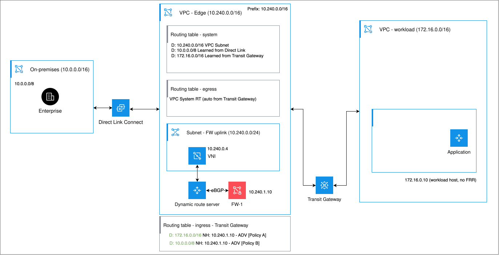
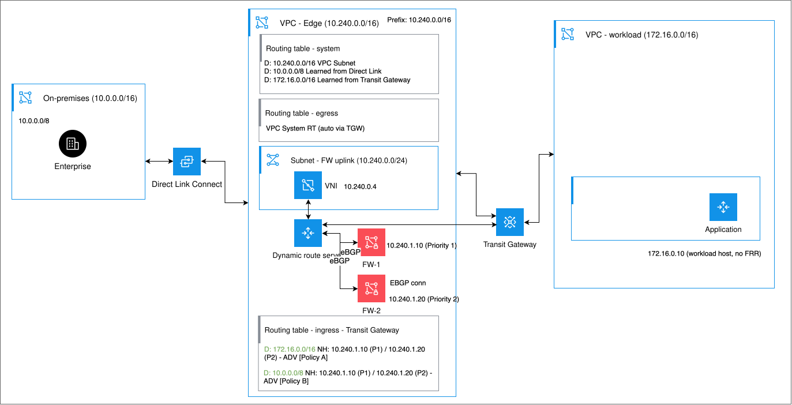
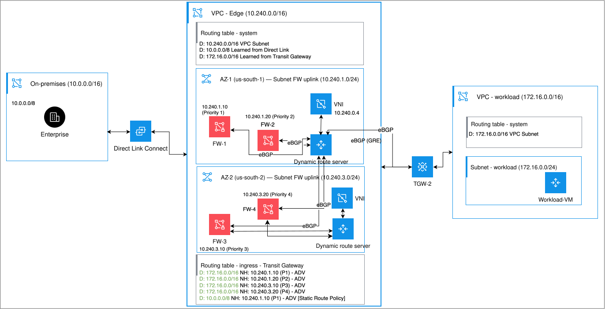
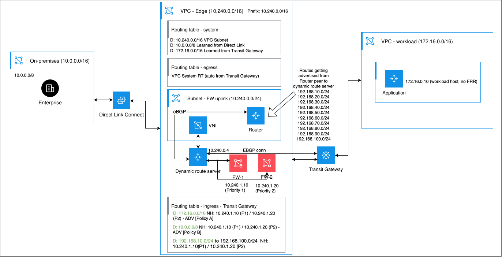
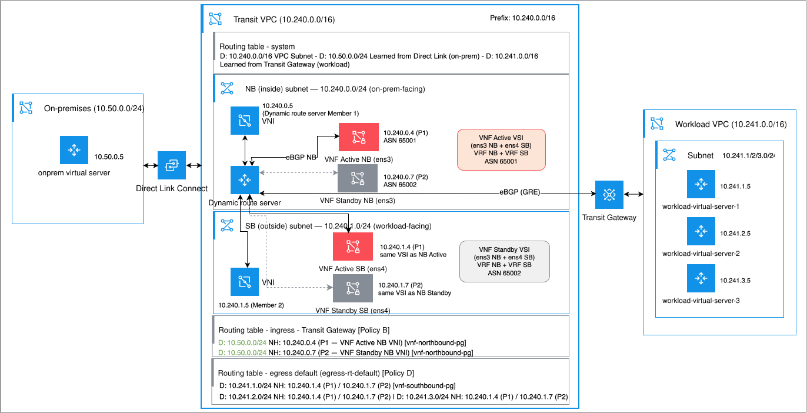

---

copyright:
  years: 2026
lastupdated: "2026-10-22"

keywords: dynamic route server

subcollection: vpc

---

{{site.data.keyword.attribute-definition-list}}

# Use cases
{: #drs-use-cases}

[Dynamic Route Server for VPC](/docs/vpc?topic=vpc-release-notes#vpc-oct2126) is a beta feature that is available for evaluation and testing purposes to select customers. Access is restricted to allowlisted accounts.
{: beta}

Dynamic Route Server for VPC supports various features and advanced networking scenarios.

## Dynamic route server features
{: #drs-features}

Dynamic Route Server for VPC includes the following features:

Dynamic route exchange
:   Establishes eBGP sessions with external peers, such as routers, firewalls, SD-WAN devices, and transit gateways, to dynamically learn and advertise network routes.

Policy-driven routing
:   Uses routing policies that you define to control how routes are learned, reflected, advertised, or added to VPC routing tables.

Integration with Transit Gateway
:   Integrates with {{site.data.keyword.tg_full}} as a read-only spoke by using redundant GRE tunnels with eBGP, enabling dynamic route exchange.

High availability
:   Backs the server instance with one or more members that are deployed across availability zones. This design provides appliance-level redundancy and continuous route exchange during failures.

Static routing
:   Dynamically adds static routes to VPC routing tables. Unlike traditional static routes, the static routes are health-aware and are automatically added or removed based on the health of the next-hop peer group.

## Use case 1: Routing traffic through a single firewall as a next hop
{: #use-case-1-drs}

You can use a dynamic route server to advertise routes through a single firewall that acts as the next-hop device for VPC traffic. The dynamic route server learns routes from BGP peers and dynamically adds health-aware routes into VPC routing tables to steer traffic through the firewall for inspection. If the firewall becomes unavailable, the associated routes are withdrawn to prevent traffic blackholing.

{: caption="Single firewall as next hop example" caption-side="bottom"}

The IP addresses, CIDR ranges, ASNs, and resource names used in this example are for illustration purposes. Replace them with values that match your environment. To set up this configuration, follow these steps:

1. Create the VPC infrastructure.

   1. Create an edge VPC with CIDR `10.240.0.0/16`.
   1. Create a subnet in the edge VPC for the dynamic route server and firewall, for example `10.240.0.0/24`.
   1. Create a workload VPC with CIDR `172.16.0.0/16`.
   1. Create a workload subnet, for example `172.16.0.0/24`.
   1. Configure security groups to allow BGP, BFD and any additional specific traffic that is required for routing control.

   For more information, see [Getting started with Virtual Private Cloud (VPC)](/docs/vpc?topic=vpc-getting-started) and [Using the IBM Cloud console to create VPC resources](/docs/vpc?topic=vpc-creating-a-vpc-using-the-ibm-cloud-console).

1. Create the Direct Link and Transit Gateway connectivity

   1. Order a Direct Link connection between your on-premises network (`10.0.0.0/16`) and {{site.data.keyword.cloud_notm}}.
      - Connect the on-premises network (`10.0.0.0/16`) to Direct Link.
      - Connect the edge VPC (`10.240.0.0/16`) to Direct Link.

   1. Create a Transit Gateway connection.
      - Connect the workload VPC (`172.16.0.0/16`) to Transit Gateway.
      - Connect the edge VPC (`10.240.0.0/16`) to Transit Gateway.
      - Configure a deny prefix filter of `10.0.0.0/8` and `172.16.0.0/16` on the edge VPC connection.

   1. Verify that the following connections are established:
      - On-premises network to Direct Link
      - Edge VPC to Direct Link
      - Workload VPC to Transit Gateway
      - Edge VPC to Transit Gateway

   For more information, see [Getting started with IBM Cloud Direct Link](/docs/dl?topic=dl-get-started-with-ibm-cloud-dl) and [Creating a transit gateway](/docs/transit-gateway?topic=transit-gateway-ordering-transit-gateway&interface=ui).

1. Provision the virtual server instances

   1. Assign IP address `10.240.1.10` to the firewall, FW-1.
   1. Enable IP forwarding on the firewall.
   1. Make sure that a host in your on-premises network (`10.0.0.0/16`) can send traffic over Direct Link.
   1. Deploy a workload host in the workload VPC with IP address `172.16.0.10`.

   For more information, see [Creating virtual servers for VPC](/docs/vpc?topic=vpc-about-advanced-virtual-servers#creating-vsis-for-vpc).

1. Provision the dynamic route server

   1. Create an ingress routing table in the edge VPC.
   1. Create a virtual network interface (VNI) in the edge VPC subnet.
   1. Assign IP address `10.240.0.4` to the VNI.
   1. Provision a dynamic route server instance.
   1. Attach the VNI to the dynamic route server and configure the ASN.

   For more information, see [About routing tables and routes](/docs/vpc?topic=vpc-about-custom-routes) and [Creating a dynamic route server](/docs/vpc?topic=vpc-drs-create).

1. Connect the dynamic route server to Transit Gateway

   1. Make sure that a GRE tunnel is established between the dynamic route server and Transit Gateway.
   1. Verify that BGP peering is established.
   1. Verify that the dynamic route server learns the workload VPC prefix `172.16.0.0/16` from the transit gateway.

1. Configure firewall peer group and route advertisement

   1. Create a firewall peer group on the dynamic route server.
   1. Add FW-1 (`10.240.1.10`) as a next-hop peer and enable BFD on the peer.
   1. Create a peer group policy of type VPC routing table for destination `172.16.0.0/16` with next hop `10.240.1.10`.
   1. Create a peer group policy of type VPC routing table for destination `10.0.0.0/8` with next hop `10.240.1.10`.
   1. Configure both policies to add routes into the edge VPC ingress routing table.

   For more information, see [Attaching a peer to a peer group](/docs/vpc?topic=vpc-drs-attach-peer-to-group&interface=ui) and [Creating a peer group policy](/docs/vpc?topic=vpc-drs-create-peer-group-policy).

1. Verify route updates

   1. Verify that the ingress routing table contains the following CIDR ranges:
      - `172.16.0.0/16` to `10.240.1.10`
      - `10.0.0.0/8` to `10.240.1.10`
   1. Verify that both routes are advertised by the dynamic route server.

1. Validate traffic flow and failover

   1. From the on-premises host, send traffic to the workload host `172.16.0.10`.
   1. Verify that traffic traverses the firewall FW-1.
   1. Remove the policy for `172.16.0.0/16` and verify that connectivity is lost.
   1. Re-create the policy and verify that connectivity is restored.
   1. Stop firewall FW-1 and verify that the dynamic route server withdraws the added routes.
   1. Restart firewall FW-1 and verify that the routes are automatically reinstated and connectivity is restored.

This configuration enables the dynamic route server to dynamically steer traffic through a single firewall while automatically withdrawing routes during firewall failures to prevent traffic blackholing.

## Use case 2: Routing traffic through dual firewalls with priority-based failover
{: #use-case-2-drs}

You can use a dynamic route server with two firewall appliances in the same availability zone to provide an active and standby traffic path. Each firewall is added as a next-hop peer in the same peer group with a different priority. The dynamic route server adds routes to the VPC ingress routing table for both firewalls simultaneously, but the VPC routing table uses the numerically lower priority value as the active path. When the primary firewall becomes unavailable, the dynamic route server detects the failure through BFD and removes the primary route entry. The VPC routing table then automatically uses the standby firewall's route entry, which was already present, redirecting traffic without manual intervention. When the primary firewall recovers, its route entry is reinstated and traffic returns to the primary path.

Before you configure dual firewalls, complete the VPC infrastructure, transit gateway, and dynamic route server setup described in [Use case 1](/docs/vpc?topic=vpc-drs-use-cases#use-case-1-drs). Then add a second firewall to the same peer group with a higher priority number.

{: caption="Dual firewalls with priority failover example" caption-side="bottom"}

## Use case 3: Deploying firewalls across multiple availability zones
{: #use-case-3-drs}

You can use a dynamic route server in a multi-zone architecture to maintain traffic steering through firewalls even when an entire availability zone becomes unavailable. In this topology, firewalls are deployed in two or more availability zones and added to the same next-hop peer group with zone-aware priorities. Firewalls in the primary zone receive the lowest priority numbers and are preferred for forwarding. Firewalls in secondary zones receive higher priority numbers and serve as cross-zone fallback.

The dynamic route server adds route entries for all firewalls to the VPC ingress routing table simultaneously. As long as a firewall in the primary zone is healthy, all traffic uses that zone's firewall. If all firewalls in the primary zone fail, the dynamic route server removes those route entries and the VPC routing table automatically begins using the next-lowest priority entries, which belong to firewalls in a different zone. When the primary zone recovers, its firewalls resume as the active path.

The key difference from use case 2 is zone placement. Use case 2 uses two firewalls in the same zone for intra-zone redundancy. In this use case, the firewalls are placed across zones for zone-level fault tolerance, so that your routing configuration survives a full zone outage. Both use the same priority-based mechanism.

{: caption="Multi-AZ firewall deployment example" caption-side="bottom"}

## Use case 4: Learning routes from router peer groups
{: #use-case-4-drs}

You can use a dynamic route server to establish BGP peering with one or more routers through a router peer group and use policies to control how learned routes are distributed across your network. In this topology, the dynamic route server peers with a router in the workload VPC that advertises overlay network prefixes. A learned routes policy reflects those prefixes to other peer groups, and a VPC routing table policy adds them to the ingress routing table with the firewall as the next hop. This process allows the dynamic route server to act as a route reflector between routing domains, so that on-premises hosts can reach overlay workloads without the need for manual route updates.

A router peer group is configured with the Router role, which means that the peer participates in route exchange over BGP. This setup is different from a next-hop peer group where the peer is a forwarding target only. When you configure a router peer group, you provide the IP address and ASN of the router peer. The dynamic route server establishes a BGP session with the router and begins learning the routes that it advertises.

{: caption="Route learning with router peer group example" caption-side="bottom"}

## Use case 5: Routing traffic through active and standby firewalls in a single VPC
{: #use-case-5-drs}

You can use a dynamic route server to steer all north-south and east-west traffic within a single VPC through a pair of active and standby virtual network functions (VNFs) acting as firewalls or security appliances. The route server establishes BGP peering with both VNFs on their northbound and southbound interfaces, learns workload and default routes, and dynamically adds health-aware routes into VPC routing tables. With BFD enabled, the dynamic route server can detect VNF failures in less than one second and automatically redirect traffic to the standby VNF without manual intervention.

{: caption="Routing traffic through active and standby firewalls in a single VPC example" caption-side="bottom"}

## Use case 6: Advertising a fixed on-premises path through a static route
{: #use-case-6-drs}

Static routes work differently from learned routes. Their destination, next-hop peer group, and target routing tables come from your configuration, not from a BGP session. The dynamic route server uses the zone and priority of the peers in the next-hop peer group to determine which route entries to add. The same ingress and egress ranking rules apply, but no BGP advertisement from a peer is required.

This setup is useful when a destination prefix is fixed and well known, and you do not want to depend on a BGP peer to advertise it. A common example is a stable on-premises CIDR such as `10.0.0.0/8`.

In the same topology as use case 1, you can define a static route directly on the dynamic route server instead of relying on a custom routes policy:

- Destination: `10.0.0.0/8`
- Next-hop peer group: the firewall peer group
- Target routing table: the edge VPC ingress routing table
- Advertise: enabled

The dynamic route server adds the destination route `10.0.0.0/8` to the ingress routing table with the firewall as the next hop. This process doesn't require any peer to advertise the route. When advertising is enabled on the static route, the route is passed to the transit gateway through the edge VPC connection so that other connections in the workload VPC are aware of it.

The health-aware behavior for static routes is the same as for learned routes. If the firewall peer group becomes unhealthy, the static route entry is withdrawn. When the peer group recovers, the entry is reinstated. This mechanism is what separates it from a plain VPC static route: the dynamic route server owns the lifecycle of the route and ties it to peer health.
