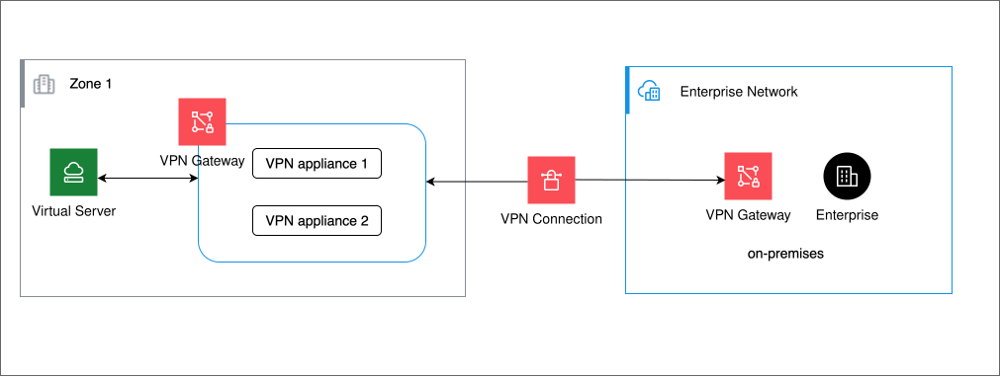
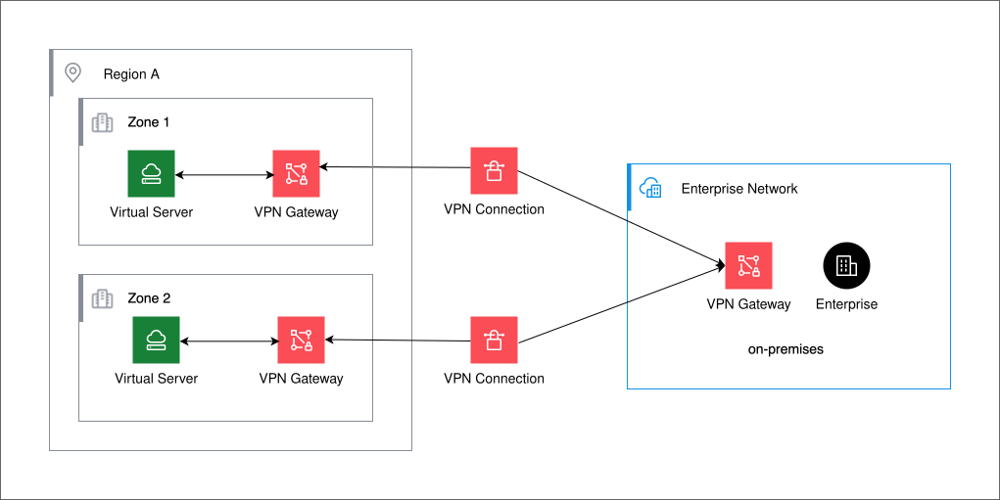
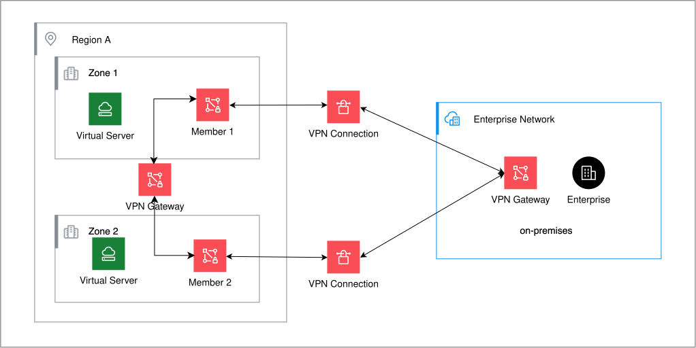

---

copyright:
  years: 2022, 2026
lastupdated: "2026-10-28"

keywords: VPN, vpn gateways, HA, High availability, Redundancy

subcollection: vpc

---

{{site.data.keyword.attribute-definition-list}}

# Understanding high availability for VPN for VPC
{: #vpn-ha}

[High availability](#x2284708){: term} (HA) is the ability for a service to remain operational and accessible in the presence of unexpected failures.

VPN for VPC is a regional service and you can find the available region and data center locations in the [Service and infrastructure availability by location](/docs/overview?topic=overview-services_region) documentation. As a regional service, VPN for VPC fulfills the defined [Service Level Objectives (SLO)](/docs/resiliency?topic=resiliency-slo) with the Standard plan. The SLO is not a warranty and IBM doesn't issue credits for failure to meet an objective.

To enable HA in a VPN gateway, you must deploy a VPN gateway in each zone that is associated with the subnet that you select. This action helps ensure that the VPN gateway can connect only to virtual server instances within that specific zone. For fault tolerance across multiple zones, you must create a separate VPN gateway in each zone. For example, in a VPC with three zones (us-south1, us-south2, and us-south3), each zone requires its own VPN gateway (`gateway1` for us-south1, `gateway2` for us-south2, and `gateway3` for us-south3).

When you provision a VPN gateway, two appliances are created automatically within the zone, functioning in an *active-active* or *active-standby* configuration. For a policy-based VPN, you must explicitly choose HA, while for route-based VPNs, HA is the default behavior. If one appliance fails, the other automatically takes over to ensure uninterrupted service. However, VPN gateways don't support multiple zone redundancies (MZR) and are confined to a single zone, which means that a VPN gateway cannot connect across different zones.

When you provision a VPN gateway, two appliances are created automatically, functioning in an Active-Active or Active-Standby configuration. For route-based VPNs, HA is the default behavior. If one appliance fails, the other automatically takes over to ensure uninterrupted service.

{{site.data.keyword.cloud_notm}} VPN for VPC supports two high availability modes for route-based VPN gateways:

* **Zonal HA**: Both appliances are deployed within a single availability zone. This mode is the default for all VPN gateways, including policy-based gateways. For zone-level fault tolerance with this pattern, you must create a separate VPN gateway in each zone. For example, in a VPC with three zones (`us-south-1`, `us-south-2`, and `us-south-3`), each zone requires its own VPN gateway.
* **Regional HA**: A single route-based VPN gateway deploys its two appliances across two subnets that can span different availability zones. If one zone fails, the appliance in the other zone continues handling traffic without requiring a separate VPN gateway resource. See [VPN gateway high availability with a regional gateway](#vpn-ha-regional).

## High availability architecture
{: #ha-architecture-vpn}

This section provides an overview of the high availability architecture for a VPN gateway, starting with a depiction of a single-zone configuration followed by a discussion of a multi-zone region setup for enhanced redundancy and fault tolerance.

### VPN gateway high availability in a single-zone
{: #vpn-ha-in-single-zone}

A VPN gateway is composed of two back-end instances within the same zone to ensure high availability. The VPN service continuously monitors these instances and automatically fails over to the other instance during failure. Routine maintenance of the VPN is conducted through rolling upgrades of the two back-end instances. During maintenance, the VPN’s private IP address might change, but the public IP addresses remain unaffected, and your VPN connections automatically switches to the available instance.

{: caption="VPN gateway HA in single zone" caption-side="bottom"}

### VPN gateway high availability with multiple zonal gateways
{: #vpn-gateway-ha-multiple-zonal-gateways}

During a network outage in a specific [zone](#x2070723){: term}, you might lose network access to all resources within that zone, including a zonal VPN gateway. To ensure high availability with zonal gateways, distribute your workload across multiple zones with a separate VPN gateway in each zone, and implement load balancing between zones.

The following diagram illustrates how to distribute your workload across [multizone regions](#x9774820){: term} by using one zonal VPN gateway per zone. Each VPN gateway provides access to the VPC network within the same zone, which helps ensure resilience and minimizes the impact of localized outages.

{: caption="VPN gateway HA with multiple zonal gateways" caption-side="bottom"}

### VPN gateway high availability with a regional gateway
{: #vpn-ha-regional}

A regional route-based VPN gateway provides zone-level resiliency with a single gateway resource. Its two appliances are each assigned to a separate subnet, and those subnets can span different availability zones within the same region. If one zone becomes unavailable, the appliance in the other zone continues handling VPN traffic, and routes automatically converge to the healthy member.

The following diagram illustrates how to distribute your workload with a regional gateway and two member appliances.

{: caption="VPN gateway HA with a regional gateway" caption-side="bottom"}

Regional VPN members do not have to be in different zones. You can deploy both appliances in the same zone initially and move one to a different zone later without re-creating the gateway.
{: note}

Key differences from the multiple zonal gateways pattern:

* Only one gateway resource to manage, instead of one per zone.
* Each appliance has its own private IP address and floating IP address.
* During rolling upgrades, BGP routes are withdrawn from the appliance being upgraded, shifting traffic to the other appliance. This process makes upgrades nondisruptive.
* If an appliance's zone or private IP changes after recovery, the VPN service automatically notifies any connected transit gateways to update its generic routing encapsulation (GRE) tunnels. For more information, see [About IBM Cloud Transit Gateway](/docs/transit-gateway?topic=transit-gateway-about).

   When a member is moved to a different zone, its floating (public) IP address changes because floating IPs are zone-specific. You must update the peer configuration on your on-premises VPN appliance to use the new public IP address for that member. Otherwise, the IPsec tunnel fails to establish connection with the member.
   {: important}
